# B3-1 · AWS에 웹 서비스를 배포하고 안전하게 정리하기

이 README는 **목표 → 구조 → 보안 → 검증 → 문제 해결 → 리소스 정리** 순서로 설명할 수 있도록 구성했습니다. 각 절의 인용문은 발표할 때 읽을 수 있는 설명입니다. 상세 증빙은 문서 마지막에서 펼쳐볼 수 있습니다.

**현재 상태(2026-10-09):** 외부 접속 검증을 마치고 실습 서버·네트워크를 정리했습니다. 사진은 실습 당시 결과이며 현재 운영 중인 서버는 없습니다. 필수 제출물 4종은 보관했고 GitHub main 브랜치에 업로드를 완료했습니다. 과제 제출 완료 여부는 별도로 확인해야 합니다.

## 1. 무엇을 만들었나요?

> AWS 서울 리전에 네트워크와 서버를 직접 만들고, Nginx로 웹 페이지를 배포했습니다. 외부 브라우저에서 페이지가 열리는 것을 확인한 뒤 실습 리소스를 정리했습니다.

| 항목 | 결과 |
|---|---|
| 배포 환경 | AWS 서울(ap-northeast-2), Ubuntu EC2 1대, Nginx |
| 페이지 문구 | Hello Cloud Mission / AWS EC2 + VPC + Nginx |
| 외부 접속 검증 | **A 방식: 브라우저 접속** |
| 종료 전 검증 URL | **http://3.35.53.2/** |
| 검증 시점 | 2026-10-09, 리소스 종료 전 |

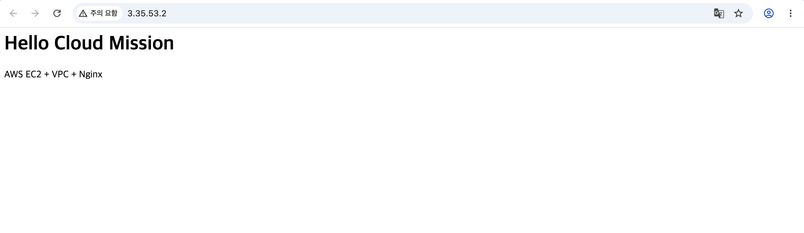

최초 실습은 2026-09-09에 진행했습니다. 당시 공개 IP는 `43.201.48.130`이었고, 10월 9일 재개 후 `3.35.53.2`로 바뀌었습니다. 현재 서버는 삭제되어 위 주소는 재접속 안내가 아닙니다.

## 2. 요청이 서버까지 어떻게 도달하나요?

> VPC 안에 Public Subnet을 만들고 EC2를 배치했습니다. 인터넷 게이트웨이를 VPC에 연결하고 외부 통신 경로를 설정했습니다. 공개 IP로 들어오는 웹 요청은 보안 그룹의 허용 규칙을 통과해 Nginx에 도달합니다.

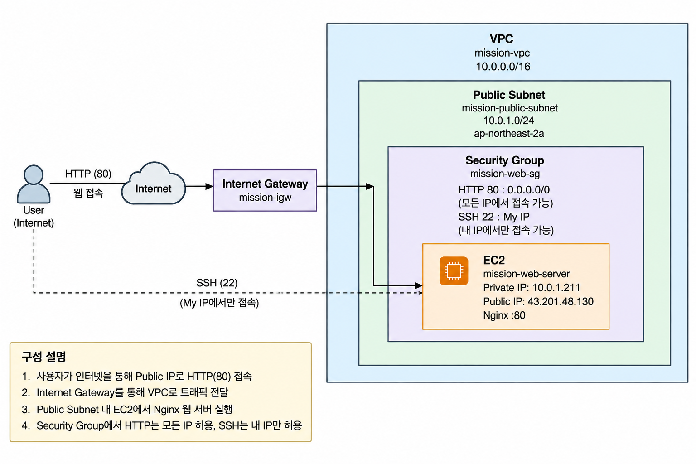

구성도는 최초 실습 당시 자료이므로 공개 IP가 `43.201.48.130`으로 표시되어 있습니다. 재개 시점 주소는 앞의 결과 표를 따릅니다.

| 구성 요소 | 역할 | 이번 실습 설정 |
|---|---|---|
| VPC | AWS 안에서 사용하는 독립된 네트워크 범위 | mission-vpc, 10.0.0.0/16 |
| Public Subnet | VPC 안에서 EC2를 배치할 주소 범위. IGW로 향하는 경로를 사용 | mission-public-subnet, 10.0.1.0/24 |
| Route Table | 목적지에 따라 트래픽을 보낼 경로 결정 | 0.0.0.0/0 → IGW, 실습 서브넷 연결 |
| Internet Gateway(IGW) | VPC와 인터넷 사이의 연결 제공 | mission-igw를 VPC에 연결 |
| EC2 / Nginx | 웹 서버가 실행되는 가상 컴퓨터 / 웹 요청 처리 프로그램 | t3.micro, Nginx 80번 포트 |
| EBS | EC2의 운영체제와 파일을 저장하는 디스크 | 8 GiB gp3 |

**외부 요청 흐름:** 사용자 브라우저 → 인터넷 → IGW → VPC의 Public Subnet에 있는 EC2 → Nginx → 응답.

Public Subnet에 배치하는 것만으로 웹 접속이 완성되지는 않습니다. **공개 IP·IGW 경로·HTTP 허용 규칙·실행 중인 웹 서버**가 함께 필요합니다. 라우팅 테이블과 보안 그룹은 이 흐름에 적용되는 설정입니다.

[라우팅 설정 증빙 보기](docs/screenshots/03-route-table.png)

## 3. 접근과 권한을 어떻게 제한했나요?

> 웹 페이지는 누구나 볼 수 있도록 HTTP 80번 포트를 열었습니다. 서버 관리용 SSH 22번 포트는 제 IP만 허용했습니다. AWS 리소스를 관리하는 IAM 권한도 실습에 필요한 작업 중심으로 제한했습니다.

| 구분 | 무엇을 제어하나요? | 적용 내용 |
|---|---|---|
| Security Group | EC2로 오가는 네트워크 통신 | HTTP 80: 0.0.0.0/0, SSH 22: 학습자 IPv4 /32 |
| IAM | AWS 리소스를 생성·조회·변경·삭제하는 권한 | 별도 사용자 mission-cloud-user, EC2/VPC/SG 관련 작업 중심 |

`0.0.0.0/0`은 모든 IPv4 주소, `/32`는 IPv4 주소 하나를 뜻합니다. 인바운드 규칙은 HTTP와 SSH 두 개이며, 모든 포트를 인터넷 전체에 공개하는 규칙은 없습니다. SSH 허용 주소는 촬영 당시 설정입니다.

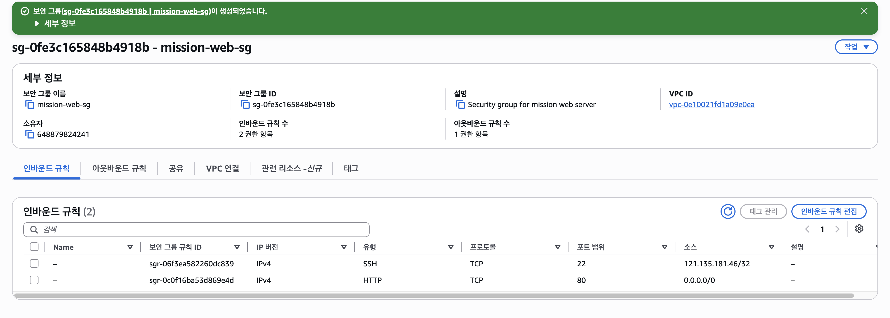

사용자 작업 기록은 루트 계정 대신 별도 IAM 사용자를 사용했다고 명시합니다. 사용자 정책 연결 화면에는 실습 정책과 `IAMUserChangePassword`가 있으며 `AdministratorAccess`는 보이지 않습니다. 보관한 [정책 JSON](iam/MissionCloudInfrastructurePolicy.json)은 EC2 API와 서울 리전 조건을 포함합니다.

IAM의 `Resource: "*"`는 남아 있어 자원별 권한 제한은 보완할 부분입니다. 실제 기본 정책 버전의 본문과 권한 동작을 AWS API로 검사하지는 않았습니다. 따라서 보관한 JSON과 AWS 기본 버전의 본문 일치 또는 유효 권한 전체가 최소권한임을 확인한 것으로 해석하지 않습니다. [IAM 검토 상세](iam/README.md)

## 4. 정상 동작을 어떻게 확인했나요?

> 서버 실행 상태부터 내부 웹 응답, 외부 인터넷 통신, 브라우저 접속까지 단계별로 확인했습니다. 내부에서만 동작하는지, 외부에서도 접근 가능한지를 나누어 검증했습니다.

| 확인 단계 | 명령 또는 방법 | 확인 결과 |
|---|---|---|
| EC2 실행 | AWS 콘솔 상태 검사 | 실행 중, 3/3 통과 |
| SSH 접속 | Mac에서 개인키로 접속 | Ubuntu 프롬프트 확인, 최초 작업 기록 기준 |
| Nginx 실행 | systemctl is-active nginx | active |
| 서버 내부 웹 응답 | curl -i --max-time 15 http://localhost | HTTP/1.1 200 OK, 페이지 본문 |
| 서버의 인터넷 통신 | curl -4 -I --max-time 20 https://example.com | HTTP/2 200 |
| 외부 사용자의 접속 | 브라우저에서 공개 IP 접속 | Hello Cloud Mission 표시 |

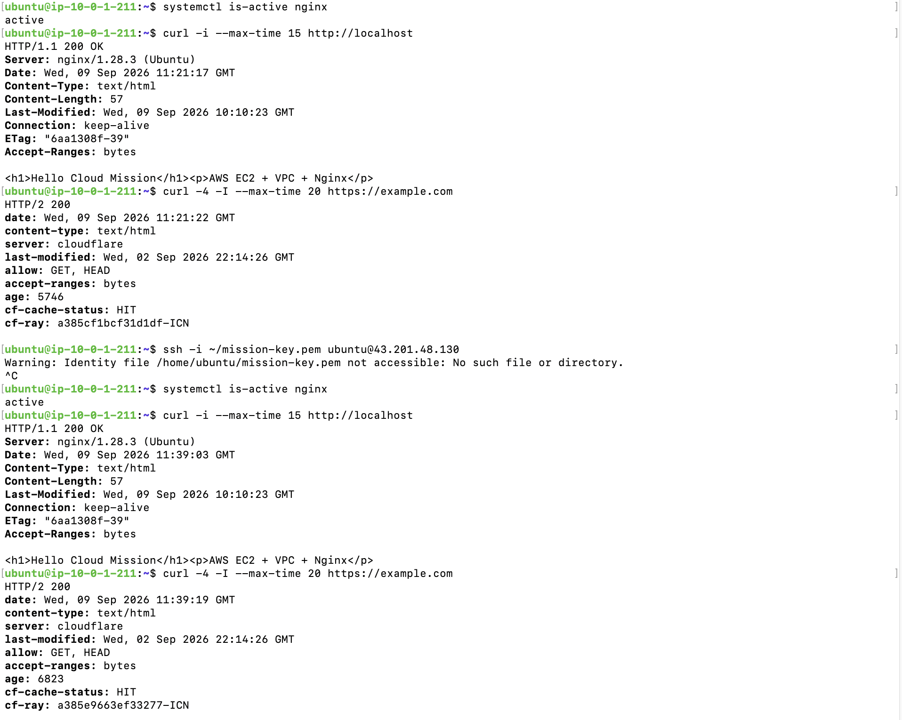

터미널 사진은 **2026-09-09 최초 실습**, EC2 실행 및 앞의 브라우저 사진은 **2026-10-09 재개 시점** 자료입니다. 10월 9일 18:38 KST에는 Codex 실행 환경에서도 외부 GET HTTP/1.1 200 OK와 같은 본문을 확인했습니다. 현재 삭제된 서버에 대한 재검증 결과는 아닙니다.

터미널 중간의 개인키 경고는 EC2 안에서 SSH를 다시 시도한 기록입니다. 앞뒤의 Nginx·curl 성공과 구분합니다. [EC2 실행 증빙 보기](docs/screenshots/05-ec2-running-2026-10-09.png)

## 5. 어떤 문제가 있었고 어떻게 대응했나요?

> 서버에서 외부 HTTPS 요청을 보냈을 때 응답이 바로 나오지 않는 문제가 있었습니다. IPv4 통신과 DNS를 확인한 뒤 IPv4를 지정해 요청했고 정상 응답을 받았습니다. 다만 최초 지연의 원인을 확정할 로그는 부족했습니다.

| 단계 | 설명 |
|---|---|
| 증상 | curl https://example.com 응답이 바로 출력되지 않아 중단 |
| 가설 | IPv6 경로·주소 선택 문제 또는 일시적인 네트워크 지연 |
| 검증 | ping 손실 0%, DNS에서 IPv6 주소 반환, curl -4로 응답 확인 |
| 조치 | IPv4 아웃바운드 검증에 curl -4 사용 |
| 결과 | Example Domain 응답 및 후속 HTTPS HTTP/2 200 확인 |
| 재발 방지 | 주소별 요청과 시간 제한으로 로그를 비교하고, 필요한 근거 없이 포트를 추가 개방하지 않음 |

IPv4 강제 요청은 확인된 우회 방법입니다. IPv6가 근본 원인이라고 확정하거나 일반 요청의 지연까지 해결했다고 주장하지 않습니다. [트러블슈팅 보고서](docs/troubleshooting.md)

## 6. 실습 후 리소스와 비용을 어떻게 정리했나요?

> 접속 성공 사진과 설정을 먼저 보관한 뒤 EC2를 종료했습니다. 디스크와 남은 네트워크 자원도 확인하고 삭제했습니다. 인터넷 게이트웨이는 VPC에서 분리한 다음 삭제했고, 마지막에 청구서를 다시 확인했습니다.

| 단계 | 완료 내용 |
|---|---|
| 서버 종료 | EC2 Terminated 확인. 단순 Stop과 구분 |
| 저장소·IP 확인 | 서울 EBS 전체 목록 비어 있음, Elastic IP 할당 없음 |
| 네트워크 정리 | 실습 SG·서브넷·실습 RT 삭제, IGW 분리 후 삭제, VPC 삭제 |
| 키페어 정리 | AWS의 mission-key 삭제 |
| 비용 재확인 | 정리 후 10월 예상 총계 USD 0.00 |

EC2를 Stop해도 디스크 등의 정리 여부는 별도로 확인해야 합니다. 이번 실습은 루트 EBS의 ‘종료 시 삭제’ 설정과 실제 빈 볼륨 목록을 모두 확인했습니다. 공유 자원과 기본 VPC는 삭제 대상에서 제외했습니다.

NAT Gateway·로드 밸런서·RDS·스냅샷은 만들지 않았다는 사용자 확인이 있습니다. NAT Gateway와 로드 밸런서는 서울 리전 빈 목록도 보관했습니다. RDS·스냅샷은 사용자 확인 기준입니다.

정리 후 청구서의 예상 총계는 **USD 0.00**입니다. 앞서 확인한 EBS 비용 USD 0.19는 크레딧으로 상쇄됐으며, 월 최종 청구액은 추후 확인 대상입니다. 리소스 삭제 여부는 청구액과 별도로 대상별 증빙으로 확인했습니다.

[리소스 정리 체크리스트](docs/cleanup-checklist.md) · [정리 후 청구서 보기](docs/screenshots/24-billing-after-cleanup-2026-10-09.png)

## 7. 제출 자료와 상세 증빙

| 미션 필수 제출물 | 위치 |
|---|---|
| 아키텍처 다이어그램 1장 | [docs/architecture.png](docs/architecture.png) |
| 외부 접속 증빙 | 이 README의 A 방식·URL·브라우저 사진 |
| 트러블슈팅 보고서 1건 이상 | [docs/troubleshooting.md](docs/troubleshooting.md) |
| 실제 정리 체크리스트 | [docs/cleanup-checklist.md](docs/cleanup-checklist.md) |

HTTPS·Docker는 선택 보너스이며 이번 실습에서는 구현하지 않았습니다. A 방식을 선택하여 `/health` 구현은 필요하지 않습니다. [미션 요구사항 원문](docs/mission-requirements.txt) · [전체 증빙 목록](docs/screenshots/README.md)

<details>
<summary>상세 증빙 펼치기 — 리소스 ID, 사진별 설명, 파일 구성, 후속 관리</summary>

## 실습 당시 구성

| 항목 | 설정 |
|---|---|
| 리전 / AZ | ap-northeast-2 / ap-northeast-2a |
| IAM 사용자 | mission-cloud-user · 실습 기록 및 사용자 정책 연결 화면 기준 |
| VPC | mission-vpc · 10.0.0.0/16 · vpc-0e10021fd1a09e0ea |
| Public Subnet | mission-public-subnet · 10.0.1.0/24 · subnet-02395a2ae539a0a0b |
| IGW | mission-igw · igw-00282b3ebdefbbd81 |
| Route Table | mission-public-rt · rtb-0993a814677ceaebd · 0.0.0.0/0 → IGW |
| Security Group | mission-web-sg · sg-0fe3c165848b4918b |
| HTTP 인바운드 | TCP 80 · 0.0.0.0/0 |
| SSH 인바운드 | TCP 22 · 학습자 IPv4 /32 · 캡처 시점의 규칙 |
| 아웃바운드 | 전체 허용 · 사용자 로그 기준 |
| EC2 | mission-web-server · i-0636b2e10b12c0414 · t3.micro |
| OS | Ubuntu Server 26.04 LTS · 사용자 로그 기준 |
| EBS | 8 GiB gp3 · vol-072179f1dd199aa87 · /dev/sda1 · 종료 시 삭제=예 |
| IP | Private 10.0.1.211 / Public 3.35.53.2 (2026-10-09 확인) |
| 키페어 | mission-key · 개인키 미포함 |

## 요구사항과 검증 근거

| 요구사항 | 근거 / 확인 범위 |
|---|---|
| VPC·Subnet·IGW·라우팅 | [라우팅 화면](docs/screenshots/03-route-table.png): IGW 기본 경로·local 경로 활성 및 명시적 실습 서브넷 연결. 생성 과정은 사용자 원본 로그 |
| SSH·Nginx·내부 HTTP 200 | [2026-09-09 터미널](docs/screenshots/06-localhost-test.png): Ubuntu 프롬프트, Nginx active, localhost GET 200 및 페이지 본문 |
| 인터넷 아웃바운드 | 같은 터미널에서 curl -4 -I --max-time 20 https://example.com → HTTP/2 200 |
| HTTP 공개·SSH 제한 | [보안 그룹](docs/screenshots/04-security-group.png): HTTP 80 전체 허용·SSH 22 /32 제한·전체 포트 공개 규칙 없음 |
| EC2 실행 | [2026-10-09 EC2](docs/screenshots/05-ec2-running-2026-10-09.png): 실행 중·상태 검사 3/3 통과·서울 AZ |
| IAM 권한 제한 | [정책 JSON](iam/MissionCloudInfrastructurePolicy.json), [사용자 연결](docs/screenshots/08-iam-user-2026-09-09.png), [버전 2 기본값](docs/screenshots/09-iam-default-version-2026-10-09.png). EC2 API와 서울 리전 조건 포함. Resource *는 보완점. [검토 상세](iam/README.md) |
| 비루트 실습 | 사용자 실습 기록은 별도 IAM 사용자 사용을 명시. 연결 화면은 사용자 존재와 정책 연결을 증명하며 모든 과거 콘솔 작업의 로그인 주체를 직접 증명하지는 않음 |
| 외부 접속 | A 방식 브라우저 캡처 및 2026-10-09 외부 GET 200 확인 |
| 무료 적용 | 무료 플랜·크레딧 및 10월 예상 청구 내역 확인. 아래 과금 확인 참고 |
| 실제 리소스 정리 | **완료** · EC2 종료·EBS 삭제·EIP 할당 없음·보안 그룹·서브넷·실습용 라우팅 테이블·IGW·VPC·키페어 삭제 및 정리 후 Billing 확인. [정리 근거](docs/cleanup-checklist.md) |

기존 내부 검증은 최초 실습 당시 자료이며 2026-10-09 SSH 재검증 결과로 표시하지 않습니다. 미션 원문에 최신 촬영 의무는 없습니다.

## 증빙 사진과 설명

사진은 촬영 시점의 상태를 보여줍니다. 최초 실습의 내부 검증과 재개 시점의 외부 접속을 구분해 정리했습니다. 외부 접속 사진은 앞의 ‘1. 무엇을 만들었나요?’에 표시되어 있습니다.

### 1. 라우팅 및 Public Subnet 연결 · 2026-09-09

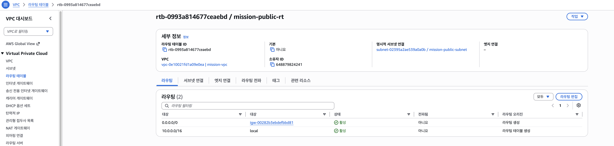

`0.0.0.0/0`의 대상이 실습 Internet Gateway이고 상태가 활성입니다. `10.0.0.0/16 → local`은 VPC 내부 통신 경로입니다. 세부 정보의 명시적 서브넷 연결에서 실습 Public Subnet이 이 라우팅 테이블을 사용함을 확인할 수 있습니다.

### 2. 보안 그룹 · 최초 실습

[보안 그룹 인바운드 사진 — 3절에 표시](docs/screenshots/04-security-group.png)

HTTP TCP 80은 `0.0.0.0/0`으로 공개하고 SSH TCP 22는 특정 IPv4의 `/32`로 제한했습니다. 캡처의 인바운드 규칙은 두 개이며 인터넷 전체에 모든 포트를 허용하는 규칙은 없습니다. SSH 허용 주소는 촬영 당시 설정입니다.

### 3. EC2 실행 상태 · 2026-10-09

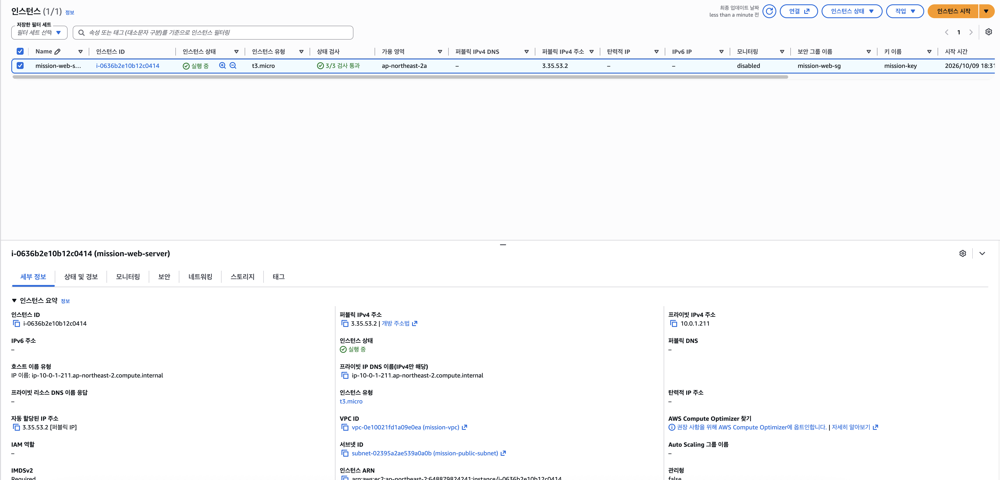

기존 인스턴스 `i-0636b2e10b12c0414`가 실행 중이며 상태 검사 **3/3 통과**를 확인했습니다. 인스턴스 유형은 `t3.micro`, 가용 영역은 서울 리전의 `ap-northeast-2a`, 재개 후 공개 주소는 `3.35.53.2`입니다.

### 4. Nginx 및 내부·외부 통신 · 2026-09-09

[Nginx 및 curl 검증 사진 — 4절에 표시](docs/screenshots/06-localhost-test.png)

Ubuntu 프롬프트에서 Nginx 상태가 `active`, localhost GET 결과가 **HTTP/1.1 200 OK**이고 사용자 페이지 본문도 반환되었습니다. `curl -4 -I`로 외부 HTTPS **HTTP/2 200**을 확인했습니다. 중간의 개인키 경고는 EC2 안에서 다시 SSH를 시도한 기록이며 앞뒤의 통신 성공 결과와 구분합니다. 이 사진은 최초 실습의 검증입니다.

### 5. 최초 외부 접속 · 2026-09-09

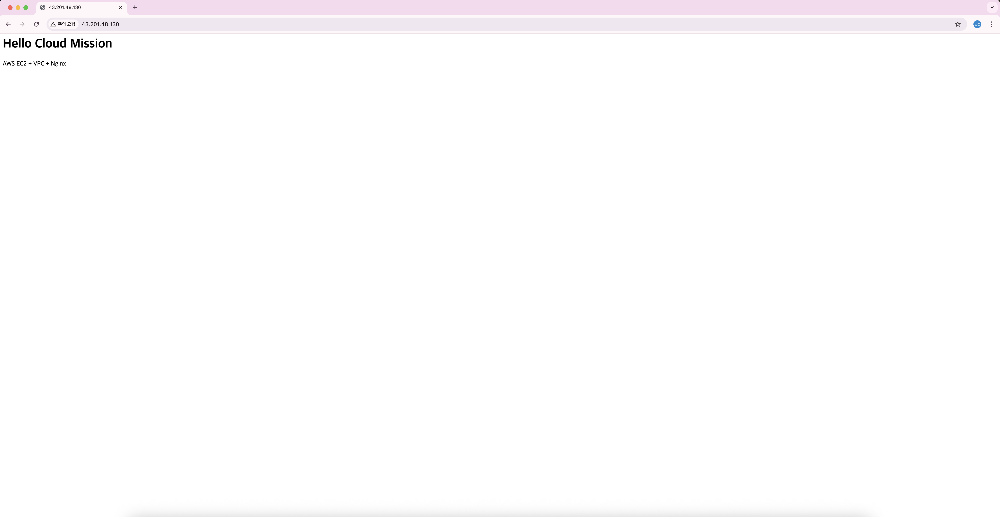

당시 공개 주소 `43.201.48.130`에서 사용자 페이지가 표시된 기록입니다. 재개 시점의 `3.35.53.2` 접속 사진과 날짜·주소가 달라 함께 보관했습니다.

### 6. IAM 사용자와 정책 연결 · 2026-09-09

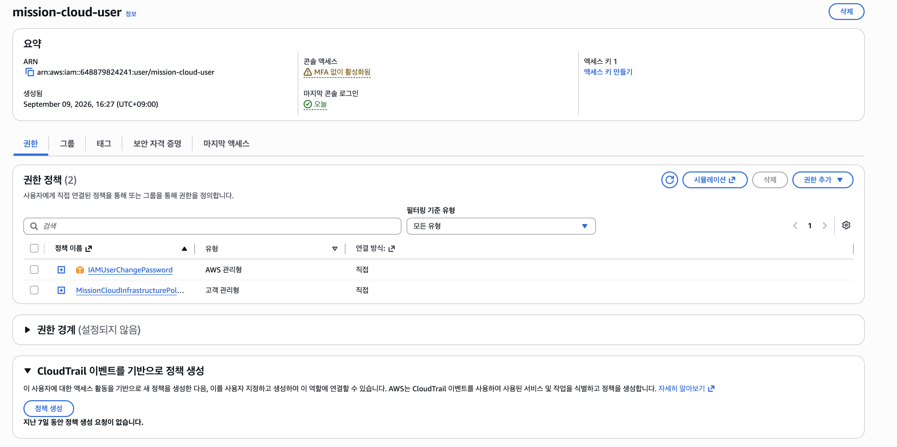

`mission-cloud-user`에 실습용 정책과 `IAMUserChangePassword`가 직접 연결되어 있습니다. 이 화면의 연결 목록에는 `AdministratorAccess`가 보이지 않습니다. 세부 권한은 [정책 JSON](iam/MissionCloudInfrastructurePolicy.json)으로 확인하며, 사용자 화면 자체가 모든 과거 작업의 로그인 주체를 증명하지는 않습니다.

### 7. IAM 기본 정책 버전 · 2026-10-09

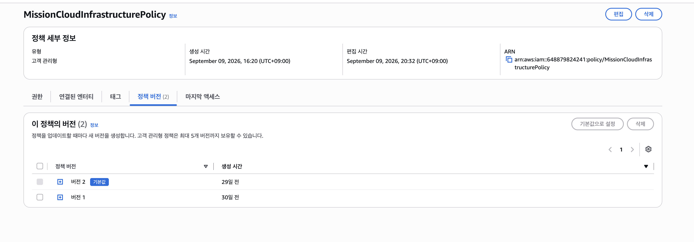

`MissionCloudInfrastructurePolicy`의 **버전 2가 기본값**으로 지정되어 있습니다. 이 화면은 버전 선택 상태를 보여주며 JSON 본문은 펼쳐져 있지 않습니다. 별도로 보관한 JSON에는 EC2 작업과 서울 리전 조건이 포함되어 있습니다.

### 8. 무료 플랜과 잔여 크레딧 · 2026-10-09

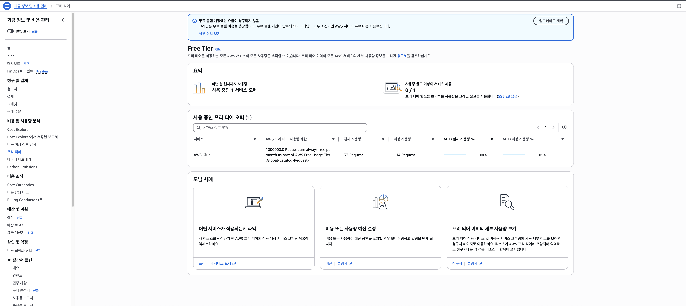

무료 플랜 안내와 잔여 크레딧 **USD 93.28**을 확인했습니다. 화면의 무료 오퍼 목록은 Glue 요청 사용량이며 EC2·EBS 비용은 아래 청구서 내역으로 확인합니다.

### 9. 10월 예상 청구서 요약 · 2026-10-09

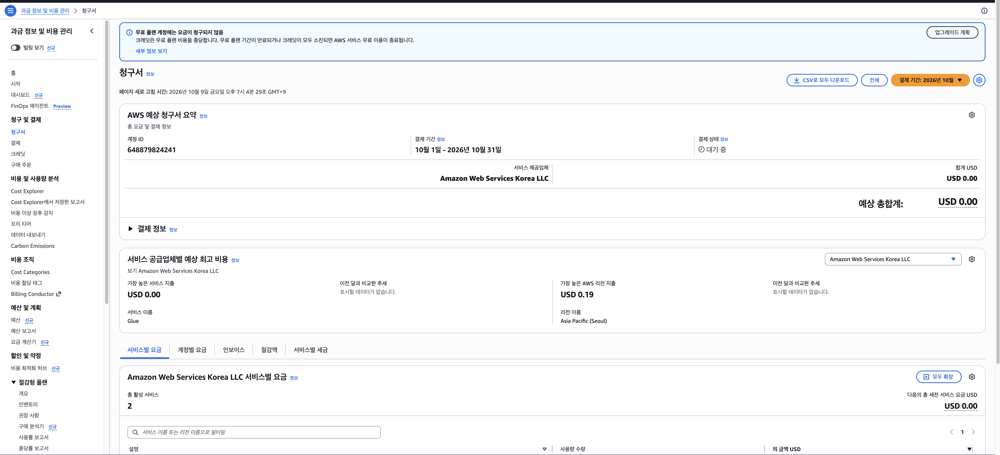

결제 기간은 2026년 10월이고 현재 예상 총계는 **USD 0.00**입니다. 월중 자료로 결제 상태가 대기 중이므로 최종 월 청구액으로 확정하지 않습니다.

### 10. EBS 사용 비용과 크레딧 적용 · 2026-10-09

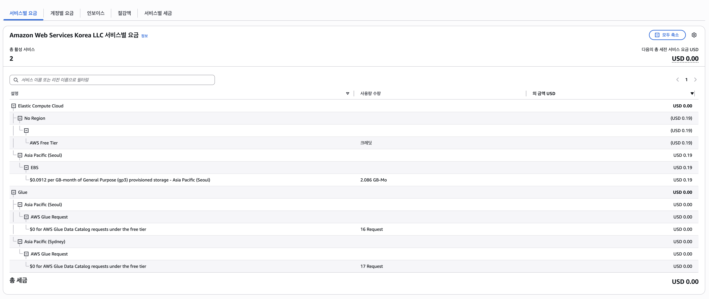

서울 EBS gp3 저장 비용 **USD 0.19**가 Free Tier 크레딧 **USD 0.19**로 상쇄되어 서비스 합계가 **USD 0.00**입니다. `2.086 GB-Mo`는 기간을 반영한 누적 저장 사용량이며 현재 볼륨 용량이 아닙니다. 이 화면은 크레딧 적용 근거로, 자원 삭제 완료 근거와 구분합니다.

### 11. 종료 전 EBS 정보 · 2026-10-09

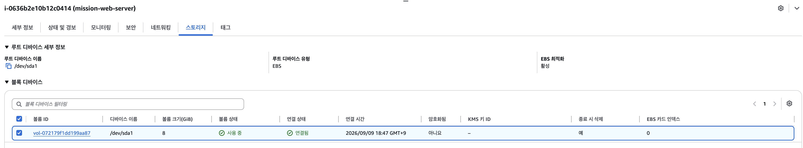

루트 볼륨 `vol-072179f1dd199aa87`은 `/dev/sda1`에 연결된 **8 GiB** 디스크이며 **종료 시 삭제=예**입니다. 촬영 당시에는 사용 중·연결됨 상태입니다. 종료 전 설정 기록이며 이후 EC2 종료와 서울 리전의 빈 볼륨 목록을 확인했습니다. [정리 체크리스트](docs/cleanup-checklist.md)에 완료 근거를 기록했습니다.

### 12. EC2 종료 완료 · 2026-10-09

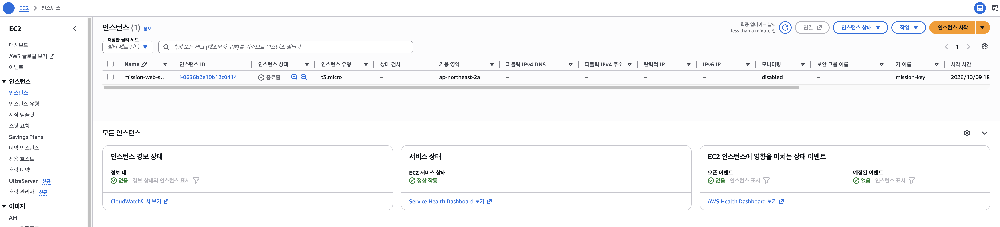

기존 실습 인스턴스 `i-0636b2e10b12c0414`의 상태가 **종료됨(Terminated)**으로 표시됩니다. 공개 IPv4도 표시되지 않습니다. 이 캡처는 EC2 종료 근거입니다. EBS와 네트워크 삭제 근거도 아래 항목에 각각 보관했습니다. 앞의 접속 주소와 실행 중 화면은 종료 전 기록입니다.

### 13. 종료 후 EBS 전체 목록 · 2026-10-09

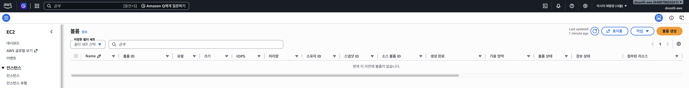

상단 아시아 태평양(서울) 표시와 필터 없는 전체 목록의 볼륨 없음 메시지를 확인했습니다. 서울 리전 잔여 EBS 볼륨이 없어 EBS 정리를 완료 처리했습니다.

### 14. 탄력적 IP 목록 · 2026-10-09

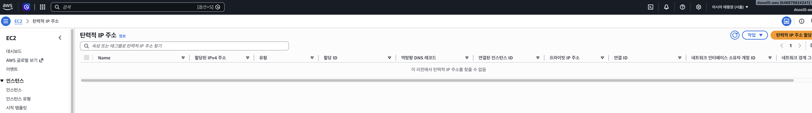

상단의 **아시아 태평양(서울)** 표시와 검색 조건 없는 목록에서 ‘이 리전에서 탄력적 IP 주소를 찾을 수 없음’을 함께 확인했습니다. 서울 리전에 할당된 탄력적 IP가 없어 릴리스는 해당 없음으로 기록하고 확인 항목을 완료 처리했습니다.

### 15. 보안 그룹 삭제 확인 · 2026-10-09

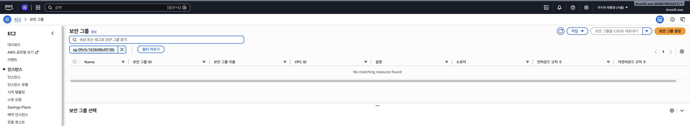

서울 리전에서 정확한 보안 그룹 ID `sg-0fe3c165848b4918b` 검색 결과가 비어 있음을 확인하여 삭제 완료 처리했습니다. 최초 인바운드 설정 증빙은 별도로 보존합니다.

### 16. 서브넷 삭제 완료 · 2026-10-09

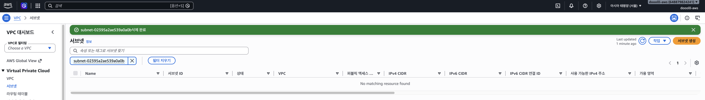

서울 리전에서 실습 서브넷 `subnet-02395a2ae539a0a0b`의 삭제 완료 배너와 같은 ID의 검색 결과 없음을 확인했습니다. 삭제 전 연결 상태는 최초 라우팅 증빙에 보존했습니다. 라우팅 테이블·IGW·VPC 삭제는 별도로 확인합니다.

### 17. 실습 라우팅 테이블 삭제 완료 · 2026-10-09

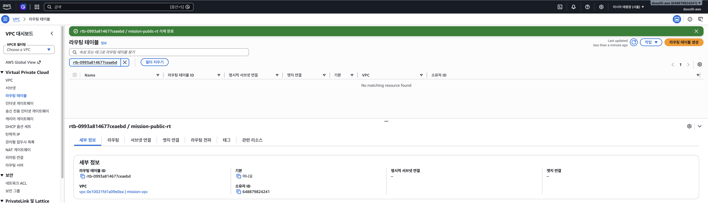

서울 리전에서 `rtb-0993a814677ceaebd / mission-public-rt` 삭제 완료 배너와 해당 ID 검색 결과 없음을 확인했습니다. 하단 세부 정보는 삭제 직후 남아 있는 선택 화면이며, 삭제 완료 판단은 배너와 갱신된 목록을 기준으로 했습니다. 기본 라우팅 테이블은 아닌 것으로 표시됩니다.

### 18. Internet Gateway 분리 및 삭제 · 2026-10-09

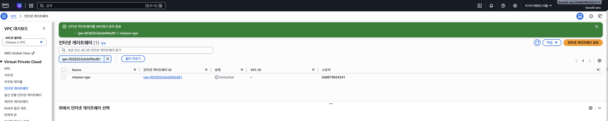

서울 리전에서 `igw-00282b3ebdefbbd81 / mission-igw`를 VPC에서 분리했습니다. 분리 완료 배너, `Detached` 상태와 VPC ID `-`가 연결 해제를 보여줍니다. 분리는 VPC 연결을 끊는 단계이고 IGW 자체는 이 시점에 남아 있습니다.

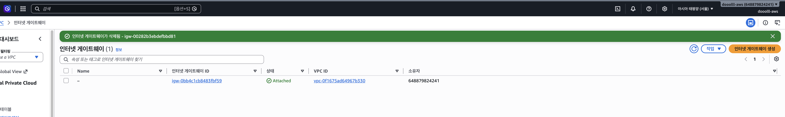

분리 후 같은 IGW를 삭제하여 해당 ID의 삭제 완료 배너를 확인했습니다. 목록에 남은 `igw-0bb4c1cb8483fbf59`는 다른 VPC에 연결된 별도 자원이며 실습 정리 대상으로 처리하지 않았습니다. **실습 IGW의 분리와 삭제를 모두 완료**했습니다.

### 19. 실습 VPC 삭제 완료 · 2026-10-09

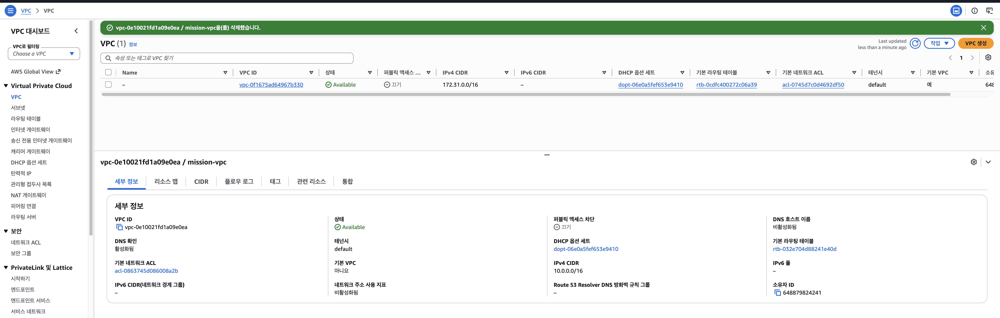

`vpc-0e10021fd1a09e0ea / mission-vpc`를 삭제했다는 성공 배너를 확인했습니다. 목록에 남은 `vpc-0f1675ad64967b330`은 CIDR `172.31.0.0/16`의 기본 VPC이며 실습 삭제 대상이 아닙니다. 하단 실습 VPC 세부 정보는 삭제 직후 남아 있는 선택 화면이며, 삭제 판단은 대상 ID의 성공 배너와 갱신된 목록을 기준으로 합니다. 이 캡처 자체에는 리전 이름이 표시되지 않지만 정확한 대상 ID의 삭제 성공을 확인할 수 있습니다.

### 20. 실습 키 페어 삭제 완료 · 2026-10-09

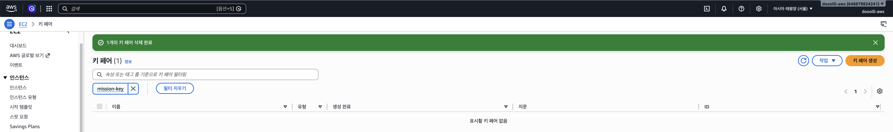

서울 리전에서 키 페어 1개 삭제 완료 배너와 `mission-key` 검색 결과 없음을 확인했습니다. AWS 키 페어 삭제 증빙이며 Mac에 보관한 개인키 파일 삭제나 IAM 사용자·정책 정리까지 의미하지는 않습니다.

### 21. 주요 리소스 정리 후 Billing 확인 · 2026-10-09

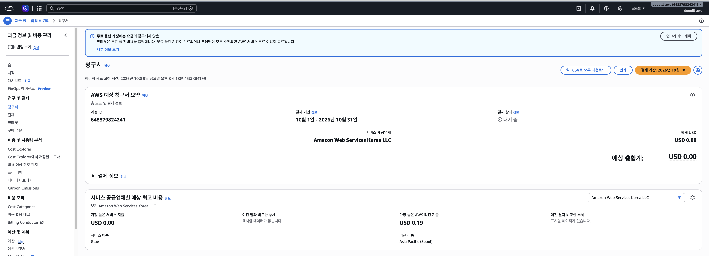

페이지 새로고침 시각은 2026-10-09 **20:18:45 KST**이고, 무료 플랜 안내 및 10월 예상 총계 **USD 0.00**, 결제 상태 대기 중을 확인했습니다. 서울 리전 지출 USD 0.19도 표시되어 있습니다. 이전 상세 내역에서는 EBS 비용을 크레딧으로 상쇄했으며, 이번 화면은 주요 리소스 정리 후 청구서 재확인 자료입니다. 최종 월 청구액이나 모든 사용량 반영 완료를 확정하지 않습니다. 자원 삭제 완료는 앞의 대상별 증빙으로 확인합니다.

### 22. 서울 리전 NAT Gateway 없음 확인 · 2026-10-09

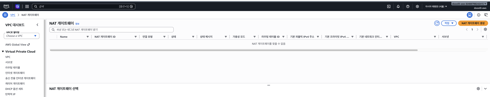

상단 아시아 태평양(서울) 표시와 검색 필터 없는 목록의 ‘NAT 게이트웨이를 찾을 수 없음’을 확인했습니다. 현재 서울 리전 NAT Gateway 잔여 자원 없음 증빙으로 보관합니다. 앞서 제공된 미국 버지니아 북부 화면과 구분합니다.

### 23. 서울 리전 로드 밸런서 없음 확인 · 2026-10-09

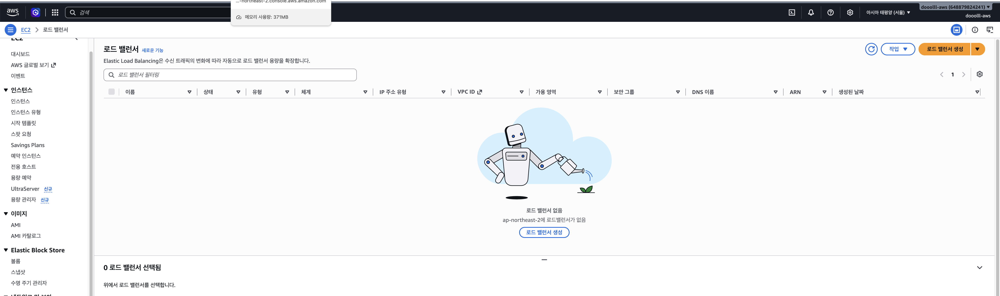

필터 없는 목록에서 ‘ap-northeast-2에 로드밸런서가 없음’을 확인했습니다. 실습 정리의 보강 증빙이며 미션 필수 제출 사진은 아닙니다.

## 무료 플랜 및 과금 확인

2026-10-09 사용자 캡처 기준:

- [무료 플랜](docs/screenshots/10-free-tier-2026-10-09.png): 무료 플랜 배너 및 잔여 크레딧 **USD 93.28**.
- [10월 예상 청구서](docs/screenshots/11-billing-summary-2026-10-09.png): 예상 총계 **USD 0.00**, 결제 상태 대기 중.
- [서비스별 내역](docs/screenshots/12-billing-details-2026-10-09.png): 서울 EBS gp3 저장 비용 **USD 0.19**, Free Tier 크레딧 **USD -0.19**, EC2 서비스 합계 **USD 0.00**. 2.086 GB-Mo는 누적 사용량이며 현재 볼륨 크기가 아닙니다.
- Glue 요청 서울 16건·시드니 17건은 각각 USD 0.00으로 표시됩니다. 요청 기록만으로 별도 배포 자원 존재를 단정하지 않습니다.

이 결과는 화면 확인 시점의 예상 청구 내역입니다. 월 최종 청구액이나 자원 삭제 완료를 뜻하지 않습니다. EC2·EBS·공개 IPv4와 생성한 추가 자원은 정리 후에도 사용 내역을 다시 확인합니다.

## 파일 구성

```text
B3-1/
├── README.md                         # 제출 안내·요구사항 대응·사진 설명
├── docs/
│   ├── architecture.png              # 필수: 구성도 1장
│   ├── troubleshooting.md            # 필수: 트러블슈팅 보고서
│   ├── evaluation-answers.md         # 발표 참고: 평가문항별 답변
│   ├── cleanup-checklist.md           # 필수: 실제 정리 근거
│   ├── screenshots/                  # 필수 외부 접속 + 보강 증빙
│   ├── mission-requirements.txt       # 과제 원문
│   └── work-log.md                    # 최초 실습 원본 기록
├── iam/                              # 실제 실습 정책 JSON·검토
├── web/deployed-index.html           # 배포 HTML 재현본
├── scripts/verify-existing.sh         # 읽기 전용 검증 참고 도구
├── WORK_LOG.md                       # 후속 작업 기록
├── AGENTS.md                         # 작업 기록 규칙
└── .gitignore                        # 개인키 등 제외 규칙
```

필수 제출 자료는 위의 README·구성도·보고서·체크리스트와 외부 접속 사진입니다. IAM·원본 기록·검증 도구는 설명 및 재현 참고 자료입니다.

## 참고 자료와 검증 도구

- [평가문항별 답변](docs/evaluation-answers.md): 이번 실습 기준 발표 답변과 가정 상황 대응 설명.
- [실습 원본 기록](docs/work-log.md): 사용자 제공 원문 보존. 문서의 예정 작업은 실제 완료로 간주하지 않습니다.
- [Codex 작업 기록](WORK_LOG.md): 문서 정리·검증 및 다음 작업 기록.
- [증빙 목록](docs/screenshots/README.md): 원본 이미지별 시점과 확인 범위.
- web/deployed-index.html: 사용자 로그에 나온 배포 HTML의 재현본이며 서버에서 다운로드한 파일은 아닙니다.
- scripts/verify-existing.sh: 기존 Ubuntu 서버의 읽기 전용 검증 참고 도구. 아래는 **종료 전 사용했던 주소를 넣은 예시**이며, 현재 삭제된 서버에는 실행할 수 없습니다.

```bash
bash scripts/verify-existing.sh "$HOME/mission-key.pem" 3.35.53.2
```

다른 승인된 실습 환경에서 재사용한다면 해당 환경의 개인키 경로·공개 IP·SSH 허용 소스를 확인합니다. 결과는 docs/evidence/에 저장됩니다.

이 실습은 AWS 콘솔에서 수동으로 구성했습니다. 제출 파일에는 실제 구성의 문서·증빙, IAM 정책, 배포 HTML 재현본과 읽기 전용 검증 도구를 보관합니다.

## 설명할 핵심

VPC는 네트워크 경계, Subnet은 그 안의 주소 범위, Route Table은 목적지별 경로, IGW는 인터넷 연결을 담당합니다. 외부 HTTP 요청이 EC2에 도달하려면 공개 IPv4·IGW 경로·HTTP 허용 규칙·실행 중인 웹 서버가 함께 필요합니다.

Security Group은 네트워크 트래픽을, IAM은 AWS API 작업 권한을 제어합니다. 전체 허용 아웃바운드와 전체 공개 인바운드는 다릅니다. 실습 정책은 관련 EC2 API와 서울 리전으로 제한했지만 Resource *가 남아 있어 자원별 제한은 추가 보완 대상입니다.

## 추가 자원 생성 여부

2026-10-09 사용자 확인에 따르면 이번 실습에서 NAT Gateway·로드 밸런서·RDS·스냅샷을 생성하지 않았습니다. 추가 삭제는 해당 없음으로 기록했습니다. 미생성 여부는 사용자 진술입니다. NAT Gateway와 로드 밸런서는 추가로 서울 리전의 빈 목록 캡처를 확인했으며, 나머지 추가 자원은 목록 직접 확인 결과가 아닙니다.

## 제출 전 확인과 후속 관리

1. 필수 제출 파일과 증빙을 보관했고 주요 자원 정리 근거를 기록했습니다. IAM 사용자·정책 재사용 여부는 선택 후속 관리이며 미션 필수 자원 삭제 항목과 구분합니다.
2. 정리 후 Billing 재확인은 완료했습니다. 이후 반영된 사용량과 월 최종 청구 내역을 다시 확인합니다.
3. 기존 제출 자료는 GitHub main 브랜치에 push 완료했습니다. 이후 문서 변경은 별도로 커밋·push하여 반영하며, 업로드와 과제 제출은 구분합니다.

</details>
